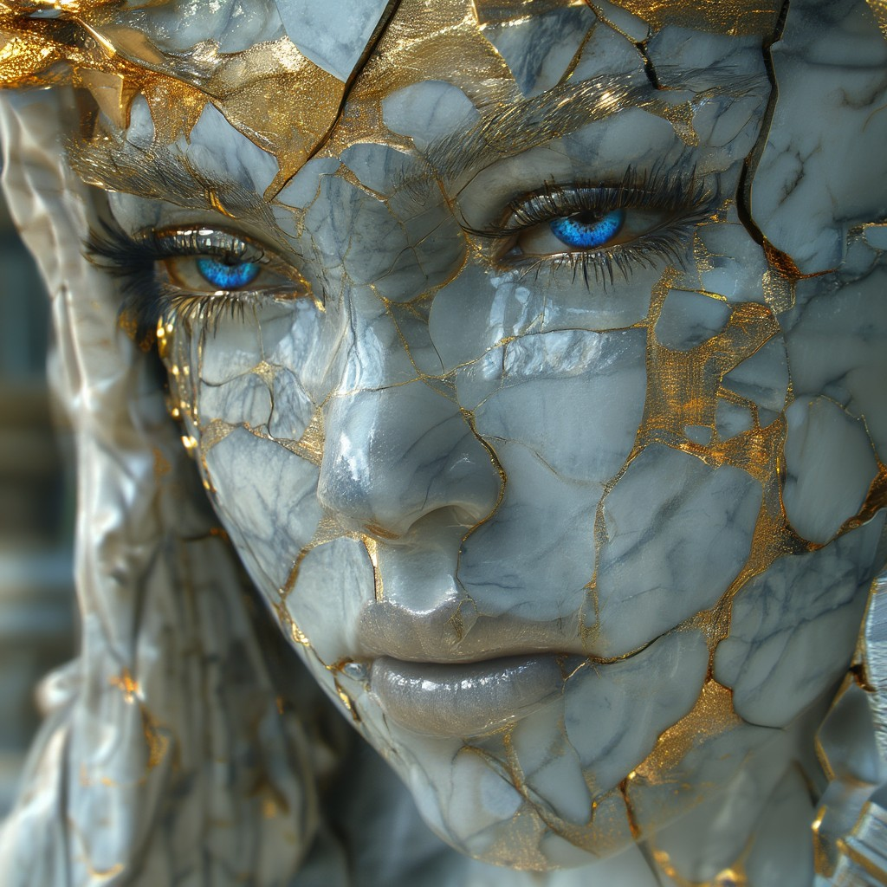
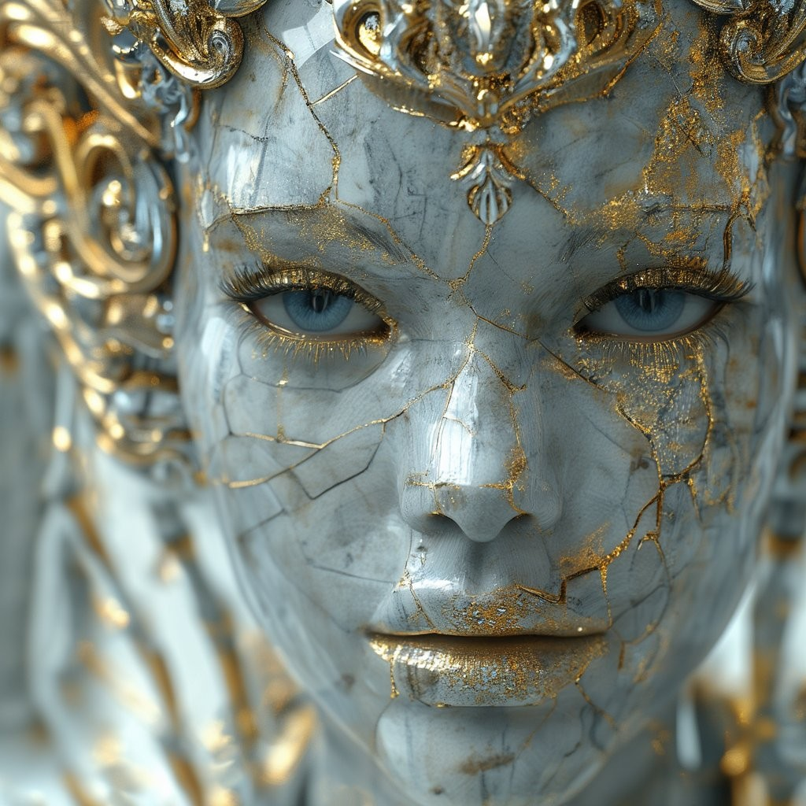
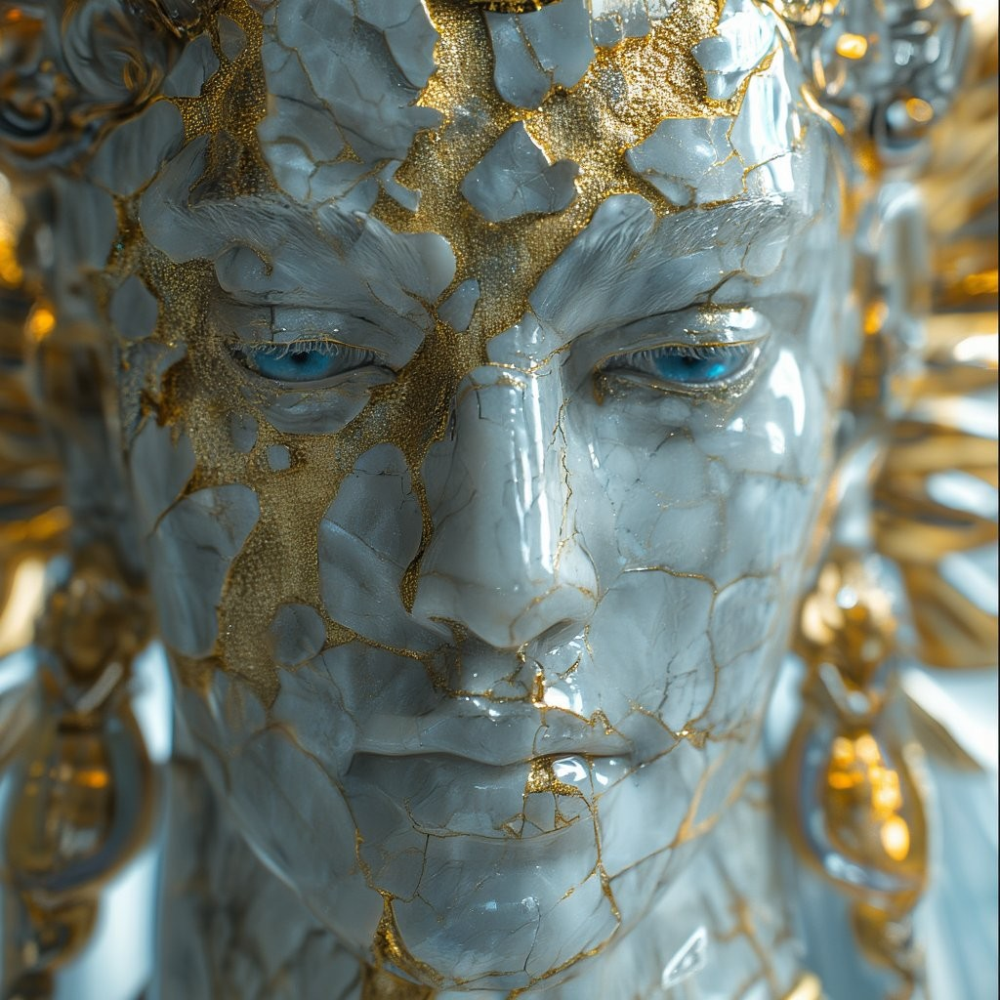

# Chroma UI

**Status: PC-proven — v1.0.** Verified on a real PC (RTX 4070 12 GB,
16 GB system RAM) on Oct 31, 2026: clean install from this bundle,
first picture, two batches back-to-back (goddess and god sets), and a
prompt-queue run — all on the default Q6_K GGUF path with CPU offload,
no silent exit and no OOM. Stub tests (63/63), a real-pipeline loader
bench, a real-Gradio launch check, and a fresh-folder bundle cold test
also pass.

A simple, standalone Gradio app for **Chroma1-HD**
(`lodestones/Chroma1-HD`) — an 8.9B text-to-image model built from
FLUX.1 [schnell] and heavily reworked by its makers. One model, one
page: prompt, negative prompt, size, steps/guidance, a prompt queue,
history, Stop, Star, and Unload. Same shape as the rest of the
Kavellion UI family (Kandinsky, Sana, Z-Image, SD 3.5, PixArt,
FLUX.1 [dev] and [schnell]).

> **License.** The *model* is **Apache 2.0** and **ungated** — no
> license acceptance, no token, no account step anywhere. The *UI
> code* in this package is MIT (Alan Carmack).

Python is **included** in this package (`python_embeded/`, Python 3.12,
ComfyUI-portable style). There is nothing to install first and no system
Python is touched or needed. Python 3.12 is required because Diffusers
0.42 dropped Python 3.10.

## Install and run (Windows, NVIDIA GPU)

1. Unzip anywhere, e.g. `C:\AI\chroma`.
2. Double-click `install.bat` once. It sets up pip in the bundled
   Python, installs PyTorch (CUDA cu130 build), then the pinned
   packages in `requirements.txt`, all into the bundled Python only.
3. Double-click `run.bat`. A browser page opens on 127.0.0.1.
4. First Generate downloads the model (see sizes below) into the
   Hugging Face cache on your user profile and loads it once; later
   generations reuse the loaded model. No token box exists — there is
   nothing to paste.

Pictures land in `images_out/` next to `run.bat` — one subfolder per
batch name, reused across runs, frames numbered continuously
(`000001.png`, `000002.png`, …), with a `settings.txt` block appended
per run (date, time, frame range, model, precision, GGUF file,
offload, size, steps, guidance, max_sequence_length, prompt, negative
prompt, expanded prompts, seeds).

## How it fits on a 12 GB card — the loader

Chroma1-HD in full BF16 is about **27.5 GB** of weights (transformer
17.80 GB, T5-XXL text encoder 9.52 GB, VAE 0.17 GB). The BF16
transformer alone is larger than a whole 12 GB card, and whole-model
CPU offload cannot stage a component that does not fit the GPU at all —
so this app offers **no BF16 path**, not even as an explicit choice.
The quantized path is the only path.

| Precision choice | Transformer file | Total weight bytes | Notes |
|---|---|---|---|
| **GGUF Q6_K (default)** | `Chroma1-HD-Q6_K.gguf`, 7.65 GB | ≈17.34 GB split by offload | Recommended for 12 GB / 16 GB |
| GGUF Q5_K_S | `Chroma1-HD-Q5_K_S.gguf`, 6.51 GB | ≈16.20 GB split by offload | Lighter, a little less detail |
| GGUF Q4_K_S | `Chroma1-HD-Q4_K_S.gguf`, 5.43 GB | ≈15.12 GB split by offload | Lightest, most headroom |

The transformer loads from the GGUF repo `silveroxides/Chroma1-HD-GGUF`
through `ChromaTransformer2DModel.from_single_file` with a
`GGUFQuantizationConfig` (the pattern in the Diffusers GGUF
documentation, and the same loader shape as the FLUX.1 UIs); the text
encoder, VAE, tokenizer, and scheduler load from `lodestones/Chroma1-HD`
with the pipeline. The pipeline receives the GGUF transformer, so the
17.8 GB of BF16 transformer shards in the base repo are **never
downloaded**. Q8_0 (9.74 GB) is deliberately **not** offered: weights
plus activations plus dequantization scratch would crowd a 12 GB card.

**CPU offload** defaults ON (`enable_model_cpu_offload`), so only one
stage's weights sit on the GPU at a time: while denoising, the T5
encoder parks in RAM (~9.5 GB — the same T5 parking the SD 3.5 and
FLUX.1 [dev] UIs already run on this PC class); while encoding, the
transformer parks in RAM instead. VAE tiling is enabled as a further
decode-time saver. Memory is freed after every image inside the
generate loop, not only at unload.

If a chosen GGUF load fails, the app falls back to the Q4_K_S file with
offload forced ON and says so in the status line. It never falls back
to full BF16 — there is no BF16 path to fall back to. First-load is the
RAM-tightest moment (all components assemble once before offload stages
them); on a 16 GB RAM machine, close other apps for the first load.

First download on the default path is ≈17.34 GB (7.65 GB GGUF
transformer + 9.52 GB T5-XXL + 0.17 GB VAE + tokenizer/scheduler/
configs).

## Defaults and controls

- Steps **40**, guidance **3.0** — the model card's own example values,
  passed explicitly on every call. (The `ChromaPipeline` class defaults
  in Diffusers 0.42.0 are 35 steps / guidance 5.0; this app follows the
  card, the same way the schnell UI passes its card values over the
  Flux class defaults.)
- **Negative prompt — real, and it works.** Chroma restored true
  classifier-free guidance (unlike FLUX.1 [schnell]'s baked guidance
  and FLUX.1 [dev]'s distilled guidance). The pipeline runs the CFG
  pass whenever guidance is above 1, so at the default 3.0 the
  negative genuinely steers. At guidance 1 or below the pipeline skips
  the pass and the negative has no effect.
- **No 77-token wall.** Chroma dropped CLIP entirely; T5-XXL is the
  only text encoder and hears the full prompt up to the pipeline's
  512-token `max_sequence_length`, which the app passes on every call.
- Size presets 1024×1024 / 768×1024 / 1024×768 / 768×768 or custom
  (rounded to a multiple of 16, the pipeline's own granularity).
- Seed box (-1 = fresh random per image; a fixed seed walks S, S+1, …),
  1–10 images per prompt, a prompt queue (one prompt per line; the
  queue beats the prompt box), single-level dynamic prompts `{a|b|c}`
  in both the prompt and the negative, Random prompt, session History
  (last 10), Stop, Star batch (copies the last batch into
  `images_out/favorites/`), and Unload models.
- Settings (`settings.txt`) records everything above per run.

## The model's character

Chroma1-HD is intentionally a **base model** — its makers describe it
as a strong, neutral foundation designed as a starting point for
finetuning. Expect base-model manners: prompt adherence and finish a
notch below a tuned release. That is the model's character, not a
fit failure. It is also a full-CFG 40-step model, so per-image time
is in the FLUX.1 [dev] class, not schnell's seconds — on an
RTX 4070 12 GB expect roughly **3.5–4 minutes per 1024×1024 image**
at the defaults. Walk-away queues are the natural way to use it.

## Not in v1

- **No LoRA slots.** LoRA-on-GGUF under CPU offload is not a verified
  combination in this build — v1 leaves the slot out rather than
  shipping one that might silently do nothing (same call as the
  FLUX.1 UIs).
- No img2img/inpaint, no ControlNet, no animation, no upscaling.

## Verification status

- Pipeline facts verified against the **installed Diffusers 0.42.0
  source** (`ChromaPipeline.__call__` signature and `check_inputs`:
  non-multiple-of-16 sizes only warn and resize; prompt+embeds raises;
  neither raises; negative+negative-embeds raises;
  `max_sequence_length` above 512 raises; CFG runs above guidance 1)
  and against the live Hugging Face API (repo file lists and byte
  sizes for the base repo and the GGUF repo, gated = false,
  license = Apache 2.0).
- **Loader bench (new for this build):** the real silveroxides
  Q4_K_S GGUF file's tensor names and shapes were run through the
  real `convert_chroma_transformer_checkpoint_to_diffusers` and
  compared key-for-key and shape-for-shape against a real
  `ChromaTransformer2DModel` built from the live config — see
  BUILD-NOTES for the outcome.
- Stub tests mirror the real defaults and validation (including the
  negative controls); the real-Gradio launch check serves the page
  under Gradio 5.50.0; the bundle passed a fresh-folder cold test
  (zip integrity, CRLF bats with zero parentheses anywhere,
  `python_embeded/python.exe` and `app.py` present, extracted
  `app.py` compiles, stub suite green from the fresh copy).
- **PC proof (Oct 31, 2026, RTX 4070 12 GB / 16 GB RAM):** the full
  proof order ran in one session — one single image (frame 000001,
  the kintsugi goddess below, seed 328895167; the status line named
  the Q6_K GGUF file), then a goddess batch (frames 000002–000004)
  and a god batch (frames 000005–000007) back-to-back, then a
  prompt-queue run. No silent exit, no OOM; stepping ran at about
  5.2 s/step at 40 steps. One first-load lesson is baked into this
  bundle: the T5 tokenizer chain needs `protobuf` (for the
  SentencePiece extractor) and `tiktoken` (its fallback) alongside
  `sentencepiece` — all three are pinned in `requirements.txt`, with
  a regression test that fails without them.

## Example output

All four frames: Q6_K GGUF, 1024×1024, 40 steps, guidance 3.0,
negative prompt empty, from the Oct 31, 2026 proof session.

*"A marble goddess, cracked stone skin repaired with kintsugi gold,
gold veins shining in the cracks, gold and silver filigree, piercing
blue eyes, broken glass halo, divine light, cinematic close-up
portrait, ultra detailed" — frame 000001, Chroma's first picture,
seed 328895167.*

*The same goddess prompt — frame 000003 from the goddess batch, the
fine gold-webbed read with the jeweled crown.*

*The god variant of the prompt ("marble god") — frame 000005 from
the god batch, the dark slate profile.*

*Frame 000007 from the same god batch — the heavy gold-mosaic read.*
